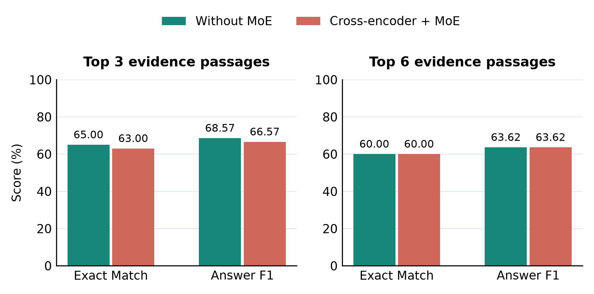
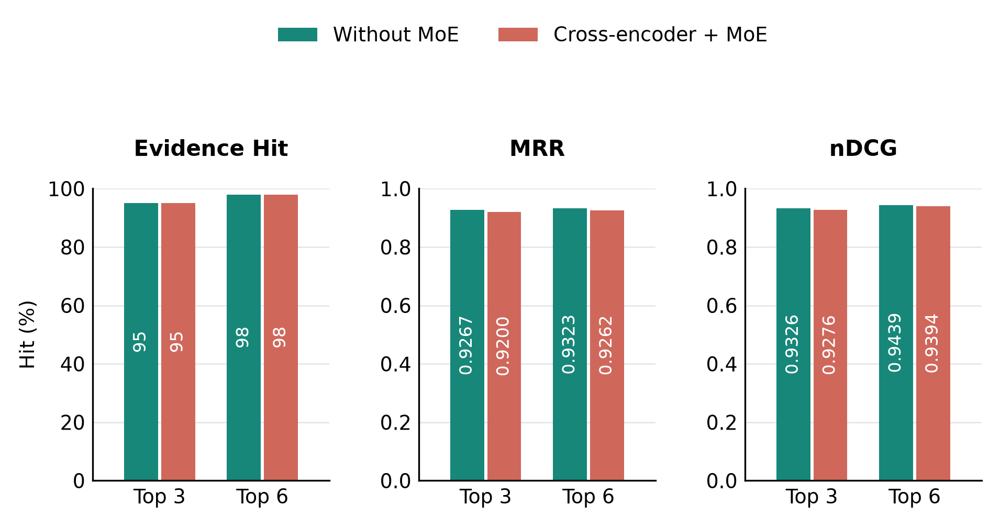
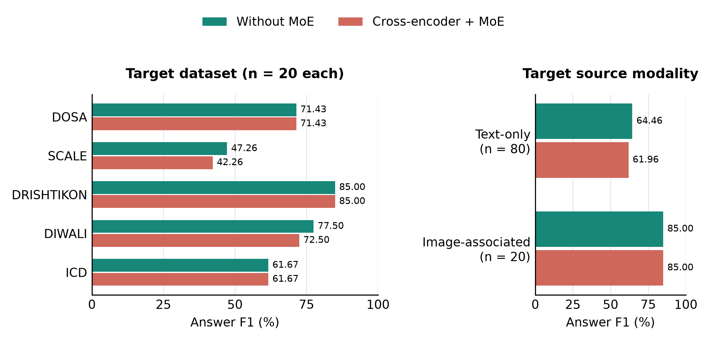

# CulturalQA RAG

**Two versions of cultural question answering: Without MoE and unrestricted Cross-encoder + MoE.**

Python · PyTorch · Transformers · Sentence Transformers · LangChain · FAISS · BM25 · CLIP · Groq

Search covers **DOSA, SCALE, DRISHTIKON, DIWALI, and Indian Cultural Dataset**. Durga QA and GIMMICK are excluded. Answers are extracted from retrieved text. Standalone image requests use shared CLIP retrieval and return existing images, not generated visual answers.

## The two versions

| Version | Entry point | Final text ranking |
|---|---|---|
| **Without MoE** | `main_without_moe.py` | Cross-encoder score |
| **Cross-encoder + MoE (unrestricted)** | `main_with_moe.py` | `Z(cross_encoder_score) + 0.25 * Z(moe_similarity)` |

Both versions use the original question and optional cached paraphrases, search all available datasets with FAISS and BM25, merge rankings, and use a cross-encoder to produce the **same shortlist of up to 12 distinct evidence references**. They select the final **3 or 6** contexts for the same extractive reader. Dataset hints adjust weights and budgets without excluding other datasets. Exact-ID lookup is a separate application path outside the factual benchmark.

`Z` standardizes scores within one question's shortlist. Unrestricted MoE can change any candidate's position and top-K membership. There are **no protected rank bands or near-tie restrictions**.

The expert architecture is unchanged: frozen BERT/CLIP features, projections, one always-active concatenation expert, and three routed experts (attention, low-rank tensor interaction, and element-wise product). The gate contributes the top two routed outputs alongside the shared expert. All routed outputs are computed before selection. Text-only records use zero image input, which becomes a learned constant after projection. The reader consumes text only.

The selected inference checkpoint is **`moe_existing_checkpoint_tau0.1_fusion.pt`**, refinement epoch **20**, with development-selected mixing weight **0.25**. The `_fusion` filename describes its diagnostic checkpoint-selection metric; inference combines its score with the cross-encoder.

`main.py` defaults to Without MoE. Standalone image retrieval uses the same CLIP component through either launcher; it is not a third text version or a measured MoE image improvement.

## Recorded results and graphs

These are **saved-candidate replay measurements from 15 October 2026**, not a new end-to-end run. The text benchmark contains **100 questions across 95 source groups**, with 20 questions per target dataset. Retrieval candidates, cached expansions, and per-context reader outputs are shared. There are also 20 image queries.

| K | Version | Hit (%) | MRR | nDCG | EM (%) | Answer F1 (%) |
|---|---|---:|---:|---:|---:|---:|
| 3 | Without MoE | 95.00 | 0.9267 | 0.9326 | 65.00 | 68.57 |
| 3 | Cross-encoder + MoE | 95.00 | 0.9200 | 0.9276 | 63.00 | 66.57 |
| 6 | Without MoE | 98.00 | 0.9323 | 0.9439 | 60.00 | 63.62 |
| 6 | Cross-encoder + MoE | 98.00 | 0.9262 | 0.9394 | 60.00 | 63.62 |

**The current MoE configuration does not improve this measured benchmark.** At top 3, EM and F1 decrease by two percentage points. At top 6, aggregate EM and F1 match. Equal aggregate scores do not imply identical rankings or answers: the full shortlist order changes for 99/100 questions and top-3 membership for 39/100.







- [Revised paper PDF](paper/main.pdf) · [LaTeX source](paper/main.tex)
- [All graphs: PNG, PDF, SVG](paper/figures/) · [Graph data and provenance](paper/data/)
- [Validation matrix](validation_moe_residual_120/validation_matrix.csv)
- [Per-question predictions and metrics](validation_moe_residual_120/per_question.csv)
- [Complete recorded traces](validation_moe_residual_120/validation_report.json)

Shared CLIP image Hit is 85% at K=3 and 95% at K=6. The report stores these identical shared-component image rows under both mode names for schema consistency; they are not separate image models. The report contains 400 text and 80 image condition/cutoff rows.

Fusion-feature extraction averages approximately 0.971 seconds and learned reranking 0.009 seconds per text query in the saved replay. This approximately 0.98-second component cost is not an independently measured end-to-end latency difference.

## Setup and data

Use a separate Python environment. The recorded environment used Python 3.14; installed versions are in [requirements-tested.txt](requirements-tested.txt). Other platforms or Python versions require compatible dependencies.

```bash
python3 -m venv .venv
source .venv/bin/activate
python -m pip install -r requirements.txt
cp .env.example .env
```

Set `GROQ_API_KEY` locally for new query expansions. No key is needed with expansion disabled or when the question's expansion is cached. Encoder and reader weights must be downloaded from their providers or already cached.

**Raw datasets, image downloads, FAISS indexes, and environments are not bundled.** Obtain data under the providers' terms:

- [DOSA](https://github.com/microsoft/DOSA)
- [SCALE Cultural Data](https://github.com/google-research-datasets/SCALE-Cultural-Data)
- [DIWALI](https://huggingface.co/datasets/nlip/DIWALI)
- [DRISHTIKON](https://huggingface.co/datasets/13ari/DRISHTIKON)
- [Indian Cultural Dataset](https://huggingface.co/datasets/ombhojane/indian-cultural-dataset)

Expected layout:

```text
data/raw/DOSA/<state>/*.csv
data/raw/SCALE/*.xlsx
data/raw/DIWALI/*.csv
data/raw/DRISHTIKON/*.csv
data/raw/Indian Cultural Dataset/*.json
```

DRISHTIKON images must be present at paths resolved by its loader. Then build the index:

```bash
python main.py --build
```

Strict research validation checks the corpus, labels, split, and model provenance. A rebuilt index can change fingerprints or record IDs. Changed data require a new documented split, reviewed labels, training, and development selection. Historical results are not measurements of a newly built index. See [index coverage](research/index_coverage_summary.json).

## Run both versions

Use identical settings. These examples enable available candidate image features in both pipelines, matching the paper's modality setting:

```bash
python main_without_moe.py --ask "Which beach in Visakhapatnam is described as a venue for Navy air shows?" --candidate_k 12 --top_k 3 --enable_images
python main_with_moe.py --ask "Which beach in Visakhapatnam is described as a venue for Navy air shows?" --candidate_k 12 --top_k 3 --enable_images
```

Use `--top_k 6` for six contexts. Add `--no_query_expansion` to both commands for an expansion-disabled comparison. Omitting `--enable_images` from both produces a text-feature-only experiment, which differs from the recorded paper configuration.

```bash
python main_without_moe.py --questions_file questions_100.txt --enable_images --output my_answers.json
python main_with_moe.py --image_query "Find Shondol dancers performing outdoors in Ladakh." --output my_images.csv
```

## Validation and checks

With the matching original corpus/index available, run a **fresh two-condition evaluation**:

```bash
python validation.py --suite validation_queries_120.json --candidate_k 12 --output_dir my_validation_two_versions
```

Images are enabled by default in `validation.py`. `--text_only` disables image features for text reranking; image queries still use CLIP. `--max_queries 2` provides a small integration check. Reports contain aggregate metrics, per-question traces, visible reader errors, and paired source-group bootstrap intervals. Fresh runs are saved separately from the paper results.

Verify saved paper measurements **without downloading models or datasets**:

```bash
python verify_results.py
```

Run regression tests after installing the model libraries:

```bash
python -m unittest test_research test_two_versions
python -m unittest discover -s experiments/moe_improvement -p 'test_*.py'
```

The full-corpus test is skipped when the unbundled data/index are absent. Fixture tests and saved-result verification are not a new end-to-end benchmark.

## Training and provenance

The cross-encoder baseline is pretrained, not locally trained. MoE training uses 300 weak source-derived anchors and 60 development anchors. Source-group and exact-image-alias splitting separate supervision; appropriate knowledge documents remain searchable, including evidence for held-out questions.

```bash
python research_train.py
python experiments/moe_improvement/run_experiment.py
python experiments/moe_improvement/global_development.py
```

These are the triplet-training, listwise-refinement, and global development-selection stages. They require the matching data, encoders, and frozen features. Multiple MoE development settings are training candidates, not additional published inference versions. Run new training in a separate checkout: these commands write new training artifacts and selection metadata and can change the model used by `main_with_moe.py`.

`checkpoints/moe_fusion.pt` is the initial training checkpoint needed by refinement and provenance checks, not an alternative CLI ranker. The selected refined checkpoint's bytes and historical metadata are preserved. Embedded historical fingerprints may mention artifacts from the original development work; these describe provenance, not active runtime dependencies. Training helpers now support MoE only. The expert architecture, selected weights, and ranking formula are unchanged. Earlier source versions remain recoverable from commit `7977962` and Git history.

## Limitations

- The benchmark was inspected previously and is not a new blind test. Source verification used AI assistance; independent human expert review is not recorded.
- Relevance annotations identify known positives, not exhaustive corpus-wide judgments.
- Training uses weak supervision and one seed. The comparison does not isolate expert mixing from extra parameters, training, and image access.
- Indian Cultural Dataset indexing covers only 4.24% of source characters; 11/96 records are fully indexed.
- Image-associated and text-only targets are source strata, not a controlled image-masking experiment.
- The paired top-3 F1 interval reaches zero. This study does not establish general superiority of either architecture.
- Image retrieval is related to [RetVQA's image-pool setting](https://arxiv.org/abs/2306.16713), but does not reproduce its full visual-answer generation method.

## Main files

| Location | Purpose |
|---|---|
| `main_without_moe.py`, `main_with_moe.py` | The two supported text versions |
| `pipeline.py`, `retrieval.py`, `reader.py` | Shared retrieval and answer extraction |
| `moe_fusion.py`, `residual_reranker.py` | Expert architecture and unrestricted score combination |
| `image_retrieval.py` | Shared CLIP retrieval |
| `validation.py`, `verify_results.py` | Fresh paired evaluation and saved-result verification |
| `validation_moe_residual_120/` | Only the two reported conditions |
| `research/`, `experiments/moe_improvement/` | Labels, splits, coverage, and MoE training/development provenance |
| `paper/` | Corrected paper, three graphs, editable source, and plotting data |

Only the two requested inference versions are maintained in this tree. Superseded comparison files remain in Git history. Credentials and local data are excluded. Dataset and pretrained-model terms remain with their providers. Numerical results have not been improved or remeasured as part of this cleanup.
