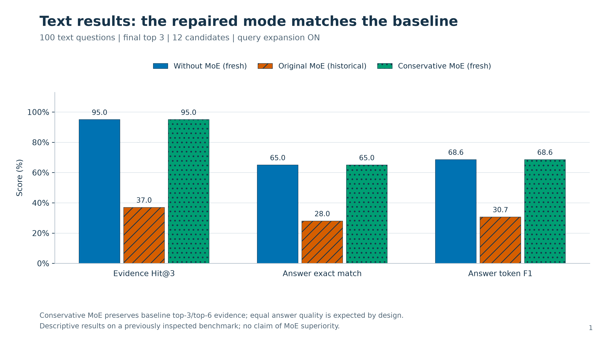

# CulturalQA RAG

**Cultural question answering and image retrieval with hybrid search, cross-encoder ranking, and Mixture-of-Experts (MoE) experiments.**

Python · PyTorch · Hugging Face Transformers · Sentence Transformers · LangChain · FAISS · BM25 · CLIP · Groq

The project searches across **DOSA, SCALE, DRISHTIKON, DIWALI, and Indian Cultural Dataset**. Durga QA and GIMMICK are excluded. Text answers are extracted from retrieved evidence. Image queries return matching images; the QA reader itself is text-only.

## What the system does

1. Optionally expand a text question into cached search paraphrases using the Groq API.
2. Search all five available datasets with FAISS dense retrieval and BM25 lexical retrieval.
3. Merge candidates with reciprocal-rank fusion and score them with a cross-encoder.
4. Keep 12 candidate records and select the final 3 or 6 evidence records.
5. Extract an answer using a shared question-answering reader, recording evidence and errors.

Exact record-ID lookup follows a separate deterministic path. Dataset hints do not restrict ordinary search to only one dataset.

### MoE architecture and the conservative repair

The fusion network has a shared concatenation expert and three routed experts: attention, low-rank tensor fusion, and element-wise multiplication. A learned gate mixes the top two routed outputs alongside the shared expert. Frozen BERT text features and CLIP image features feed this network.

The original MoE ranked candidates by fusion-vector similarity alone. The current default combines standardized cross-encoder and MoE scores:

```text
score = z(cross_encoder_score) + 0.25 * z(moe_similarity)
```

It protects the baseline's top-3 and top-6 evidence membership and reorders only bounded near ties within those groups. The maximum near-tie span is 0.05 standardized cross-encoder score units. Reader tie handling follows baseline order. The network architecture remains unchanged; scoring policy and selected trained weights differ.

**This is a conservative regression repair, not evidence that MoE outperforms the baseline.** Image-only retrieval uses explicitly labelled CLIP fallback. The simple-fusion selection currently has weight zero and also falls back to baseline ranking. `--legacy_moe` preserves the original fusion-only inference behavior.

## Recorded evaluation

The benchmark contains **100 text questions** (20 per dataset) and **20 image queries**, evaluated at K=3 and K=6. Conditions share retrieval budgets, cached query expansions, available image features, and reader behavior. Training used 300 source-derived anchors, with 60 development anchors; model and conservative-policy selection used development data.

Text results at top 3:

| Metric | Without MoE | Original MoE | Conservative MoE |
|---|---:|---:|---:|
| Evidence Hit@3 | 95.00% | 37.00% | 95.00% |
| Exact match | 65.00% | 28.00% | 65.00% |
| Answer token F1 | 68.57% | 30.67% | 68.57% |

Original MoE results are from the historical run; baseline and conservative results were freshly evaluated on the same questions. Baseline quality matched between runs. The fresh run produced 720 condition/cutoff rows with zero evaluation errors. The local research project passed 43 regression tests.



- [All eight figures in PDF](paper_figures_repaired_120/culturalqa_repaired_results.pdf)
- [Validation matrix](validation_conservative_live_120/validation_matrix.csv)
- [Per-question answers and metrics](validation_conservative_live_120/per_question.csv)
- [Example answer output](paper_figures_repaired_120/png/08_example_output.png)
- [Detailed repair explanation](MOE_REPAIR.txt)

At top 6, text Hit is 98%, exact match is 60%, and answer F1 is 63.62% for both baseline and conservative mode. Image Hit@3 is 85% and Hit@6 is 95% through CLIP fallback. Conservative text reranking adds about 1.73 seconds per question in measured processing components on the evaluation machine; this excludes model startup and is not an independent end-to-end latency benchmark.

### Research limitations

- Equality of answer quality follows from preserving baseline evidence; it does not isolate a benefit from expert mixing.
- The benchmark was inspected during diagnosis and is not a new blind test. Labels were source-checked by an AI assistant and have not received independent human expert review.
- Relevance annotations contain known positives rather than exhaustive judgements across the corpus.
- Training labels are weak/source-derived, and only one training seed is represented.
- Long-document index coverage is incomplete, especially for Indian Cultural Dataset. See [coverage measurements](research/index_coverage_summary.json).
- The image fallback is not a learned MoE image improvement or a reproduction of a visual answer-generation model.

## Setup

Use Python 3.11 or newer. The recorded local experiment used Python 3.14; dependency versions are listed in `requirements-tested.txt`. Dependency compatibility on another machine may require a separate environment.

```bash
python3 -m venv .venv
source .venv/bin/activate
python -m pip install -r requirements.txt
cp .env.example .env
```

Set `GROQ_API_KEY` locally only if generating new query expansions. No API key is needed when expansion is disabled. Pretrained encoder and reader models must be downloaded from their upstream providers or already cached.

### Data and search index

**Downloaded datasets, images, FAISS indexes, and the Python environment are not bundled.** The repository includes source code, small trained fusion checkpoints, labels, provenance, cached benchmark paraphrases, and recorded evaluation outputs.

Obtain datasets from their publishers and preserve their terms:

- [DOSA](https://github.com/microsoft/DOSA)
- [SCALE Cultural Data](https://github.com/google-research-datasets/SCALE-Cultural-Data)
- [DIWALI](https://huggingface.co/datasets/nlip/DIWALI)
- [DRISHTIKON](https://huggingface.co/datasets/13ari/DRISHTIKON)
- [Indian Cultural Dataset](https://huggingface.co/datasets/ombhojane/indian-cultural-dataset)

The loaders expect files under:

```text
data/raw/DOSA/<state>/*.csv
data/raw/SCALE/*.xlsx
data/raw/DIWALI/*.csv
data/raw/DRISHTIKON/*.csv
data/raw/Indian Cultural Dataset/*.json
```

DRISHTIKON image files must also be available at the paths resolved by its loader. After preparing the data, build a local index:

```bash
python main.py --build
```

The bundled research manifests fingerprint the original source files and index. A rebuild can change those fingerprints or record IDs. Strict validation deliberately rejects a mismatched corpus: do not bypass its checks. To conduct a new experiment on changed data, regenerate the research split, review/update evidence labels, retrain, and rerun development selection. Existing saved results remain records of the original experiment, not measurements of a newly built index.

### Ask questions

Once the data, search index, and model dependencies are available:

```bash
python main_without_moe.py --ask "Which beach in Visakhapatnam is described as a venue for Navy air shows?" --candidate_k 12 --top_k 3 --no_query_expansion
python main_with_moe.py --ask "Which beach in Visakhapatnam is described as a venue for Navy air shows?" --candidate_k 12 --top_k 3 --no_query_expansion
```

Use `--top_k 6` for six contexts. Omit `--no_query_expansion` to enable expansion. Use identical settings for comparisons; add `--enable_images` to both commands when enabling image-associated text features.

```bash
python main_with_moe.py --image_query "Find Shondol dancers performing outdoors in Ladakh." --output my_images.csv
python main_with_moe.py --legacy_moe --ask "What is Bihu?" --no_query_expansion
```

The first command explicitly reports CLIP fallback. Retrieval can still return incorrect images; a returned result is not proof of correctness.

### Validate and test

With the matching original corpus/index available:

```bash
python validation_conservative.py --suite validation_queries_120.json --candidate_k 12 --output_dir my_validation_conservative
```

This saves aggregate metrics, per-question results, complete traces, and paired source-group bootstrap intervals. `--max_queries 2` provides a small integration check. `validation.py` retains the historical unrestricted three-condition comparison.

The fixture-based regression tests can run without the full datasets. One
full-corpus integration test is explicitly skipped when the original data/index
is absent; it remains enabled in the complete research environment:

```bash
python -m unittest test_residual test_research
```

## Main files

| File or folder | Purpose |
|---|---|
| `retrieval.py` | Global FAISS/BM25 retrieval, query expansion, cross-encoder scoring |
| `moe_fusion.py` | Shared/routed expert network |
| `residual_reranker.py` | Combined scores and evidence-preserving ranking constraints |
| `residual_pipeline.py` | Conservative inference and matched comparison |
| `reader.py` | Extractive reader, span selection, visible errors |
| `validation_conservative.py` | Fresh paired validation |
| `research/` | Split, training examples, coverage, and annotation review |
| `experiments/moe_improvement/` | Listwise training and development experiments |
| `experiments/moe_release/` | Frozen conservative selection, replay/audit tools, and original launcher backups |
| `paper_figures_repaired_120/` | PNG/SVG/PDF figures and plotting inputs |

The initial provenance experiment and its older 36-question suite are documented in `RESEARCH_PROTOCOL.txt`; the newer conservative policy and 120-question evaluation are documented above and in `MOE_REPAIR.txt`.

## Publication copy

This repository was exported from a separate research project. API keys, local environments, raw datasets, large generated caches, and machine-recovery logs were excluded. Local path strings in selected report copies were redacted; predictions and numerical results were preserved. `PUBLIC_EXPORT.json` maps original and published file hashes. Embedded historical hashes identify their original measurement artifacts and may differ from a redacted public copy.

The pretrained encoder/reader weights are supplied by their upstream publishers and are not bundled here. Dataset and model terms remain with their respective providers.
